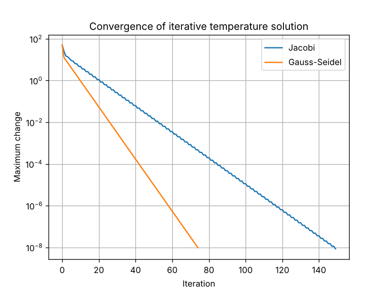
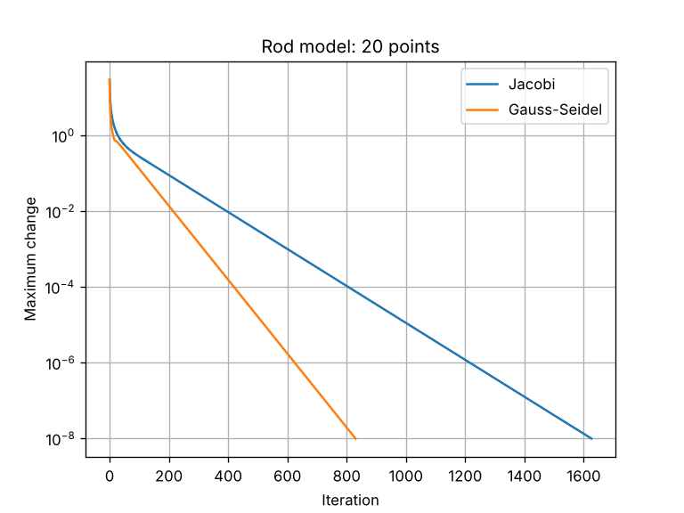

# Task 8: Iterative Methods for Linear Systems

Programs: [`code/Task_08_iterative_linear.py`](../code/Task_08_iterative_linear.py) (original) and [`code/Task_08_iterative_linear_modified.py`](../code/Task_08_iterative_linear_modified.py) (modified)

## Original program output

```text
Jacobi temperatures: [86.66666665 73.33333331 59.99999997 46.66666664 33.33333332]
Gauss-Seidel temperatures: [86.66666665 73.3333333  59.99999997 46.66666665 33.33333332]
Direct solution: [86.66666667 73.33333333 60.         46.66666667 33.33333333]
Jacobi iterations: 150
Gauss-Seidel iterations: 75
```



## B. Inputs and mathematical operation

**Input values:** a 5 x 5 matrix A (2 on the diagonal, -1 beside it) for five interior grid points, b = [100, 0, 0, 0, 20] (left boundary 100 C, right boundary 20 C), tolerance 1e-8 and at most 500 iterations.

**Mathematical operations:** the Jacobi and Gauss-Seidel methods. Start from zeros, repeatedly update each unknown from the equation, and stop when the largest change is below the tolerance. The result is compared with the direct solution.

## C. Changing a parameter

**Changes made:** the boundary temperatures were changed to 80 C and 40 C, and the tolerance was loosened to 1e-4.

**Effect:** the temperatures became 73.33, 66.67, 60.00, 53.33, 46.67 (a smaller drop from end to end). Jacobi still needed 150 iterations and Gauss-Seidel 76 at 1e-8. With a looser tolerance of 1e-4 Jacobi stopped after 86 iterations: a looser tolerance means fewer iterations but a less accurate answer.

## D. Meaning of the output

Both methods give 86.67, 73.33, 60.00, 46.67, 33.33, matching the direct solution to about 8 digits. The temperatures fall evenly from the hot end to the cold end, as expected in steady-state heat flow. **Graph:** the vertical axis is logarithmic, so each line falling steadily means the error shrinks by a constant factor each iteration. The Gauss-Seidel line falls faster, reaching the tolerance in 75 iterations compared to 150 for Jacobi, so Gauss-Seidel is about twice as fast here.

## E. Modified program for a related real-world case

**New case:** a metal rod with 20 interior points, one end heated to 60 C and the other at 30 C.

**Assumptions:** steady state, same simple model as the original, and a tolerance of 1e-8.

**Interpretation:** Jacobi needed 1627 iterations and Gauss-Seidel 831, much more than the 5-point case. More unknowns means slower convergence. Both answers are within about 1e-6 of the direct solution. The temperature drops evenly from 58.57 C at point 1 to 31.43 C at point 20. The graph again shows Gauss-Seidel converging about twice as fast as Jacobi.

**Output of the modified program** (Part C comparison, then Part E case):

```text
PART C - boundaries 80 C and 40 C, tol=1e-8
Direct   : [73.3333 66.6667 60.     53.3333 46.6667]
Jacobi   : [73.3333 66.6667 60.     53.3333 46.6667] iterations: 150
GaussSeid: [73.3333 66.6667 60.     53.3333 46.6667] iterations: 76
Jacobi iterations with looser tol=1e-4: 86

PART E - 20-point rod (60 C to 30 C)
Jacobi iterations: 1627 | Gauss-Seidel iterations: 831
Max difference from direct solution (Jacobi, GS): 6.612971006347834e-07 4.3704407204359086e-07
Temperatures at points 1, 10, 20: [58.571 45.714 31.429]
```


