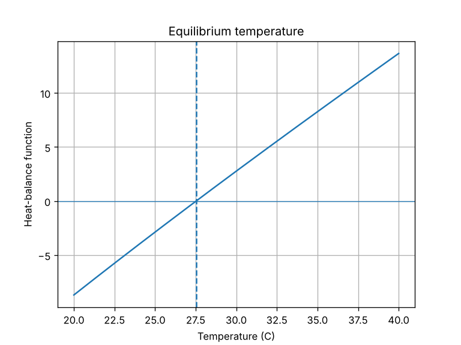
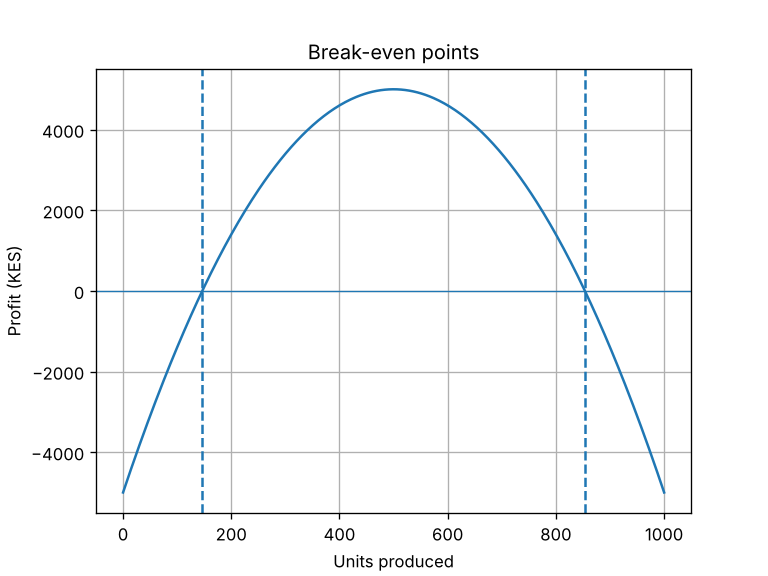

# Task 10: Root Finding: Bisection and Fixed-Point Methods

Programs: [`code/Task_10_bisection_fixed_point.py`](../code/Task_10_bisection_fixed_point.py) (original) and [`code/Task_10_bisection_fixed_point_modified.py`](../code/Task_10_bisection_fixed_point_modified.py) (modified)

## Original program output

```text
Bisection equilibrium temperature: 27.525211 C
Fixed-point equilibrium temperature: 27.525211 C
Fixed-point iterations: 13
```



## B. Inputs and mathematical operation

**Input values:** the heat-balance function f(T) = T - 25 - 10 e^(-T/20), a bracket [20, 40] where f changes sign, tolerance 1e-10; and for fixed-point iteration, g(T) = 25 + 10 e^(-T/20) with starting value 30.

**Mathematical operations:** bisection (repeatedly halve the interval keeping the sign change) and fixed-point iteration (T_new = g(T)) until the change is below 1e-10.

## C. Changing a parameter

**Change made:** the constant 10 in the model was changed to 20 (a stronger heat effect), using the bracket [20, 50] for both versions.

**Effect:** the equilibrium temperature moved from 27.525 C to 29.562 C. Both needed 39 bisection steps because the number of halvings depends on the interval width and tolerance, not on the function.

## D. Meaning of the output

Bisection and fixed-point iteration both give an equilibrium temperature of 27.525211 C. The fixed-point method took 13 iterations. **Graph:** the curve is the heat-balance function; it is negative to the left of 27.5 C and positive to the right, and the dashed vertical line marks where it crosses zero, which is the equilibrium temperature.

## E. Modified program for a related real-world case

**New case:** break-even production of a bakery.

**Assumptions:** the selling price is KES 60 per unit; costs are KES 5,000 fixed plus KES 20 per unit plus 0.04 q^2 (extra cost from crowding). Profit = 60q - (5000 + 20q + 0.04q^2). Brackets [0, 500] and [500, 1000] were used.

**Interpretation:** there are two break-even points, 146.45 and 853.55 units. Between them the business makes a profit (KES 5,000 at 500 units); below 146 it does not cover fixed costs, and above 854 crowding costs wipe out the profit. The graph is a hump with the dashed lines at the two crossings.

**Output of the modified program** (Part C comparison, then Part E case):

```text
PART C - original (10): equilibrium = 27.525211 C after 39 bisection steps
PART C - changed (20): equilibrium = 29.561521 C after 39 bisection steps

PART E - break-even quantities: 146.45 units and 853.55 units
Profit at 500 units: KES 5,000.00
```


