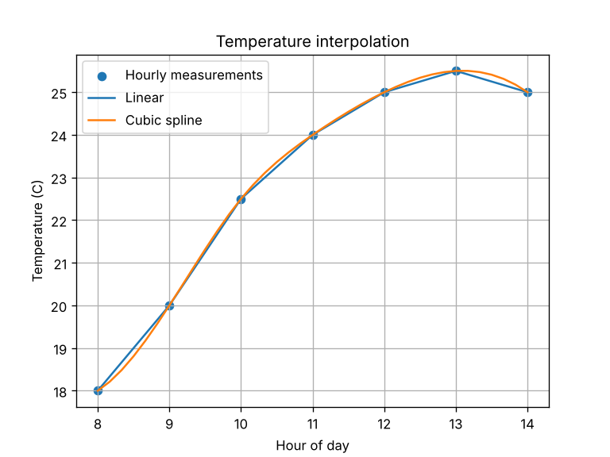
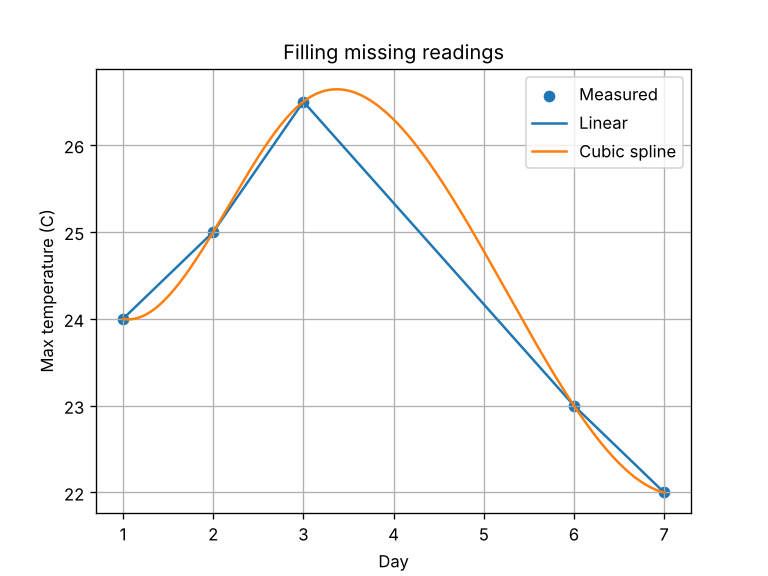

# Task 13: Interpolation

Programs: [`code/Task_13_interpolation.py`](../code/Task_13_interpolation.py) (original) and [`code/Task_13_interpolation_modified.py`](../code/Task_13_interpolation_modified.py) (modified)

## Original program output

```text
Linear estimate at 10:30: 23.25 C
Cubic estimate at 10:30: 23.36 C
```



## B. Inputs and mathematical operation

**Input values:** hourly temperatures from 08:00 to 14:00 [18, 20, 22.5, 24, 25, 25.5, 25] C, estimation every 10 minutes, and the target time 10:30.

**Mathematical operations:** linear interpolation (straight lines between neighbouring points) and a cubic spline (smooth cubic curves joined together), both evaluated at times between the measurements.

## C. Changing a parameter

**Changes made:** the target time was changed from 10:30 to 13:30, and a quadratic interpolation was added for comparison.

**Effect:** at 10:30 the linear, quadratic and cubic answers are 23.25, 23.36 and 23.36 C; at 13:30 they are 25.25, 25.385 and 25.41 C. The curved methods give slightly higher values because the temperature curve is bending (rising quickly then flattening).

## D. Meaning of the output

At 10:30 the linear estimate is 23.25 C (exactly halfway between 22.5 and 24.0) and the cubic estimate is 23.36 C, a little higher because it follows the curve. **Graph:** the dots are the hourly measurements. The linear line is made of straight segments with corners at each measurement, while the cubic spline is a smooth curve. Both pass through every measured point.

## E. Modified program for a related real-world case

**New case:** estimating two missing daily maximum temperatures.

**Assumptions:** days 4 and 5 are missing because of a sensor outage; known maximums are day 1: 24.0, day 2: 25.0, day 3: 26.5, day 6: 23.0, day 7: 22.0 C (made-up data).

**Interpretation:** linear gives 25.33 and 24.17 C for days 4 and 5; the cubic spline gives 26.30 and 24.78 C. The two methods differ by up to about 1 C because the gap is large, so the estimates are only rough. The more data is missing, the less reliable interpolation becomes.

**Output of the modified program** (Part C comparison, then Part E case):

```text
PART C - t=10.5: linear=23.250, quadratic=23.360, cubic=23.363
PART C - t=13.5: linear=25.250, quadratic=25.385, cubic=25.410

PART E - estimating missing days
Day 4,5 linear: [25.33 24.17]
Day 4,5 cubic : [26.3  24.78]
```


