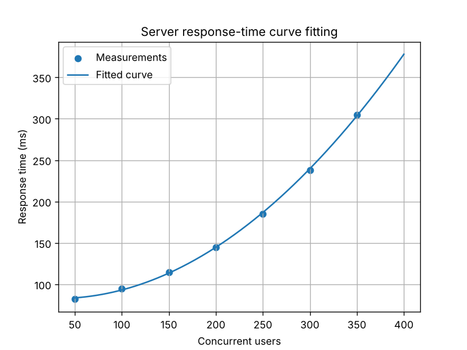
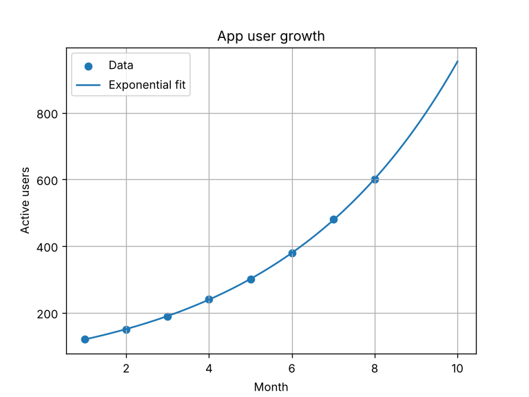

# Task 14: Curve Fitting and Approximation

Programs: [`code/Task_14_curve_fitting.py`](../code/Task_14_curve_fitting.py) (original) and [`code/Task_14_curve_fitting_modified.py`](../code/Task_14_curve_fitting_modified.py) (modified)

## Original program output

```text
Fitted model: y = 0.002167x^2 + -0.1345x + 85.00
RMSE: 1.55 ms
Predicted response at 400 users: 377.86 ms
```



## B. Inputs and mathematical operation

**Input values:** 7 measurements of concurrent users (50 to 350) and server response time (82 to 305 ms).

**Mathematical operations:** least-squares fitting of the quadratic model y = a x^2 + b x + c with `curve_fit`; the root mean square error (RMSE) measures the typical size of the misfit; the model is then used to predict the response at 400 users.

## C. Changing a parameter

**Change made:** the model was changed from quadratic to a straight line.

**Effect:** the RMSE rose from 1.55 ms to 18.83 ms and the prediction at 400 users changed from 377.9 ms to 312.9 ms. The straight line cannot follow the data, which curves upward, so the quadratic is the better model.

## D. Meaning of the output

The fitted model is y = 0.002167 x^2 - 0.1345 x + 85.00, so the response time starts at about 85 ms and the x^2 term shows delays growing faster as load increases. An RMSE of 1.55 ms means the curve misses the data by only about 1.5 ms on average. The predicted response at 400 users is 377.86 ms. **Graph:** the dots are the measurements and the curve passes very close to all of them, bending upward. The prediction at 400 is an extrapolation beyond the measured data (up to 350 users), so it is less certain.

## E. Modified program for a related real-world case

**New case:** growth of the monthly active users of a new app.

**Assumptions:** made-up data [120, 150, 190, 240, 300, 380, 480, 600] over months 1 to 8; growth is exponential, users = a e^(b t).

**Interpretation:** the fit is users = 95.24 e^(0.2304 month), about 25.9% growth per month, with an RMSE of 1.17 users. The prediction for month 10 is 954 users. Exponential growth cannot continue forever, so predictions far ahead should be treated carefully.

**Output of the modified program** (Part C comparison, then Part E case):

```text
PART C - model comparison
Quadratic: RMSE=1.55 ms, prediction at 400 users = 377.9 ms
Linear   : RMSE=18.83 ms, prediction at 400 users = 312.9 ms

PART E - app growth
Model: users = 95.24 * exp(0.2304 * month)
RMSE: 1.17 users
Monthly growth rate: 25.91%
Predicted users in month 10: 954
```


