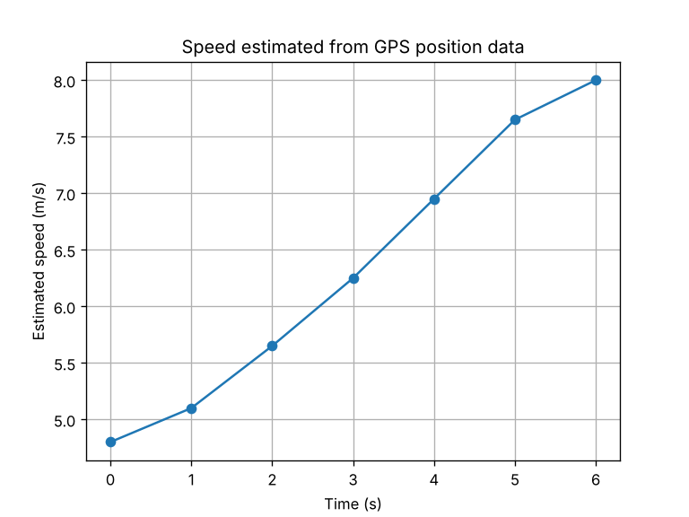
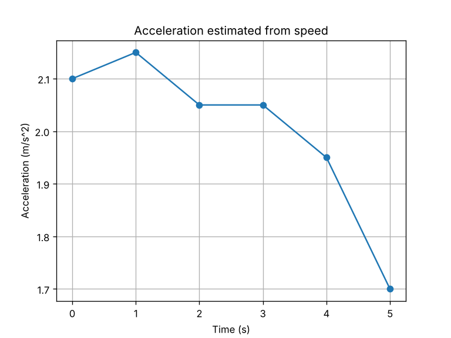

# Task 15: Numerical Differentiation

Programs: [`code/Task_15_numerical_differentiation.py`](../code/Task_15_numerical_differentiation.py) (original) and [`code/Task_15_numerical_differentiation_modified.py`](../code/Task_15_numerical_differentiation_modified.py) (modified)

## Original program output

```text
t=0s, position=0.0m, estimated speed=4.80m/s
t=1s, position=4.8m, estimated speed=5.10m/s
t=2s, position=10.2m, estimated speed=5.65m/s
t=3s, position=16.1m, estimated speed=6.25m/s
t=4s, position=22.7m, estimated speed=6.95m/s
t=5s, position=30.0m, estimated speed=7.65m/s
t=6s, position=38.0m, estimated speed=8.00m/s
```



## B. Inputs and mathematical operation

**Input values:** GPS times 0 to 6 s and positions [0, 4.8, 10.2, 16.1, 22.7, 30.0, 38.0] m.

**Mathematical operations:** speed = change in position / change in time. A forward difference is used at the first point, central differences for the interior points and a backward difference at the last point.

## C. Changing a parameter

**Change made:** the step size h was varied (0.1, 0.01, 0.001) on the test function sin(x) at x = 1, where the true derivative is cos(1).

**Effect:** the forward-difference error falls from 4.3e-2 to 4.2e-4 (10x smaller each time h is 10x smaller), while the central-difference error falls from 9e-4 to 9e-8 (100x smaller each time). Central differences are more accurate for the same h. (Making h extremely small eventually causes round-off errors, as in Task 4.)

## D. Meaning of the output

The estimated speed rises from 4.80 m/s at 0 s to 8.00 m/s at 6 s, so the vehicle is steadily speeding up. **Graph:** the line climbs from left to right, showing increasing speed. The end values use one-sided differences and are less accurate than the middle ones.

## E. Modified program for a related real-world case

**New case:** estimating acceleration of a car from speed readings.

**Assumptions:** the speed (m/s) is logged every second: [0.0, 2.1, 4.3, 6.2, 8.4, 10.1] (made-up data); `np.gradient` applies the same difference formulas.

**Interpretation:** acceleration is about 2 m/s^2 on average, a fairly steady push, with a drop to 1.70 m/s^2 at 5 s, which could mean the acceleration is easing or just the effect of the less accurate end-point formula.

**Output of the modified program** (Part C comparison, then Part E case):

```text
PART C - effect of step size h on derivative of sin(x) at x=1
h=0.1   : forward error=4.29e-02, central error=9.00e-04
h=0.01  : forward error=4.22e-03, central error=9.00e-06
h=0.001 : forward error=4.21e-04, central error=9.01e-08

PART E - acceleration from speed readings
t=0s speed= 0.0 m/s acceleration=2.10 m/s^2
t=1s speed= 2.1 m/s acceleration=2.15 m/s^2
t=2s speed= 4.3 m/s acceleration=2.05 m/s^2
t=3s speed= 6.2 m/s acceleration=2.05 m/s^2
t=4s speed= 8.4 m/s acceleration=1.95 m/s^2
t=5s speed=10.1 m/s acceleration=1.70 m/s^2
Average acceleration: 2.00 m/s^2
```


