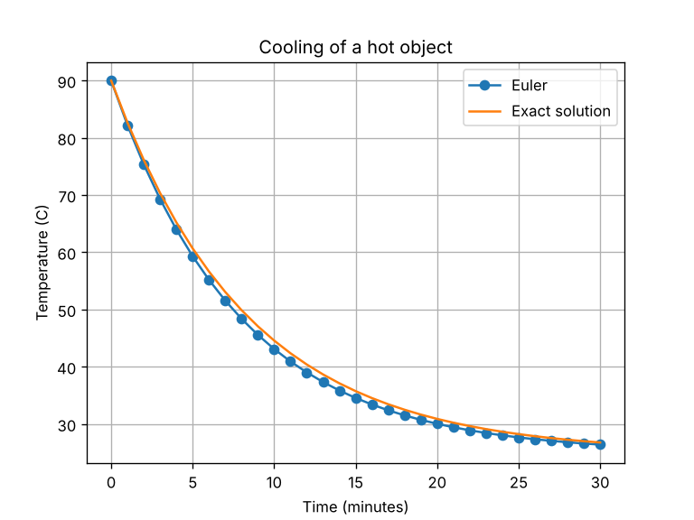
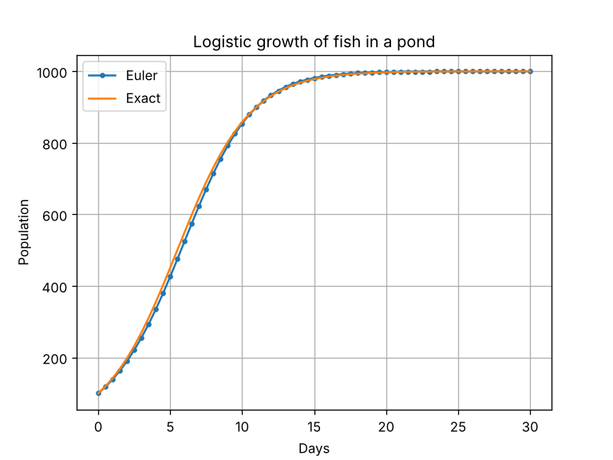

# Task 17: Ordinary Differential Equations - Euler Method

Programs: [`code/Task_17_euler_ode.py`](../code/Task_17_euler_ode.py) (original) and [`code/Task_17_euler_ode_modified.py`](../code/Task_17_euler_ode_modified.py) (modified)

## Original program output

```text
Euler temperature after 30 min: 26.40 C
Exact temperature after 30 min: 26.78 C
Final absolute error: 0.3720 C
```



## B. Inputs and mathematical operation

**Input values:** ambient temperature 25 C, initial temperature 90 C, cooling constant k = 0.12 per minute, step size h = 1 minute, end time 30 minutes.

**Mathematical operations:** Newton's law of cooling dT/dt = -k (T - T_ambient) solved with Euler's method T_next = T + h x (rate). The result is compared to the exact solution T = 25 + 65 e^(-0.12 t).

## C. Changing a parameter

**Changes made:** the step size h was changed to 5 and 0.1 minutes, and k to 0.30.

**Effect:** the final error was 1.51 C with h = 5, 0.372 C with h = 1 and 0.038 C with h = 0.1, so the error shrinks in proportion to h. With k = 0.30 the object was almost at room temperature by 30 minutes so the error was only 0.007 C.

## D. Meaning of the output

After 30 minutes the Euler estimate is 26.40 C and the exact value is 26.78 C, a final error of 0.372 C. The object cools quickly at first and then levels off towards 25 C. **Graph:** the Euler points sit just below the exact curve, meaning Euler predicts slightly too much cooling because it uses the starting rate for the whole step.

## E. Modified program for a related real-world case

**New case:** growth of fish in a pond (logistic model dP/dt = r P (1 - P/K)).

**Assumptions:** growth rate r = 0.4 per day, carrying capacity K = 1000, starting population 100, step size 0.5 days, 30 days.

**Interpretation:** the population grows slowly, then quickly, then levels off near 1000 (Euler 1000.0, exact 999.9). It passes 500 around day 6. The biggest Euler error (about 25.6 fish) occurs during the fast growth phase, as shown on the graph by the S-shaped curve.

**Output of the modified program** (Part C comparison, then Part E case):

```text
PART C - final temperature error at 30 min
h=1.0  k=0.12: Euler=26.404 C, exact=26.776 C, error=0.3720 C
h=5.0  k=0.12: Euler=25.266 C, exact=26.776 C, error=1.5098 C
h=0.1  k=0.12: Euler=26.738 C, exact=26.776 C, error=0.0383 C
h=1.0  k=0.3 : Euler=25.001 C, exact=25.008 C, error=0.0066 C

PART E - pond population (r=0.4, K=1000, P0=100, h=0.5 days)
Euler after 30 days: 1000.0 | exact: 999.9 | max error: 25.6
Day when population first exceeds 500 (Euler): 6.0
```


