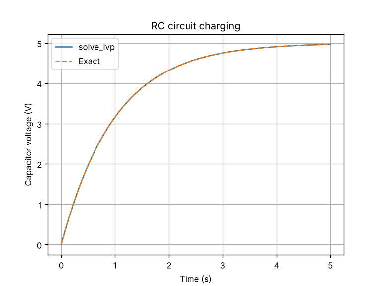
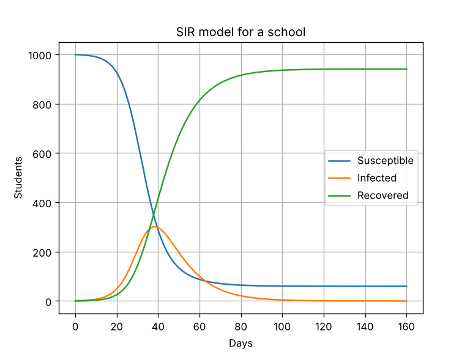

# Task 18: Numerical Solution of ODEs Using SciPy

Programs: [`code/Task_18_scipy_ode.py`](../code/Task_18_scipy_ode.py) (original) and [`code/Task_18_scipy_ode_modified.py`](../code/Task_18_scipy_ode_modified.py) (modified)

## Original program output

```text
Solver success: True
Capacitor voltage at 5 s: 4.9663 V
Maximum error against exact solution: 9.282e-10 V
```



## B. Inputs and mathematical operation

**Input values:** supply voltage 5 V, resistance 1000 ohms, capacitance 0.001 F, starting capacitor voltage 0 V, time from 0 to 5 s.

**Mathematical operations:** solve dV/dt = (Vs - V) / (R C) using `solve_ivp`, with tight tolerances, and compare with the exact curve V = Vs (1 - e^(-t/RC)).

## C. Changing a parameter

**Change made:** the resistance was changed from 1000 to 2000 ohms.

**Effect:** the time constant R x C doubled from 1 s to 2 s, so charging is slower: the voltage at 1 s fell from 3.161 V to 1.967 V, and at 5 s from 4.966 V to 4.590 V. At one time constant the capacitor is always at 63.2% of the supply (3.161 V).

## D. Meaning of the output

At 5 seconds the capacitor voltage is 4.9663 V, almost fully charged. The maximum difference from the exact solution is 9.3e-10 V, so the solver is extremely accurate. **Graph:** the voltage rises quickly at first and then flattens towards 5 V. The solid solver curve and the dashed exact curve lie on top of each other.

## E. Modified program for a related real-world case

**New case:** an epidemic in a school (SIR model).

**Assumptions:** 1000 students, 1 infected at the start, infection rate 0.3 per day, recovery rate 0.1 per day (so R0 = 3), simulated for 160 days (parameters assumed for practice).

**Interpretation:** the infection peaks at about 301 students on day 38.5. By the end about 941 students have recovered and 59 were never infected. **Graph:** the infected curve rises to a hump and falls, the susceptible curve declines, and the recovered curve rises to its final value.

**Output of the modified program** (Part C comparison, then Part E case):

```text
PART C - effect of resistance (time constant tau = R*C)
R=1000: tau=1.0s, V at 1 s=3.161 V, V at tau=3.161 V (63.2% of 5 V = 3.161 V), V at 5 s=4.966 V
R=2000: tau=2.0s, V at 1 s=1.967 V, V at tau=3.161 V (63.2% of 5 V = 3.161 V), V at 5 s=4.590 V

PART E - SIR model
Peak infected: 301 students on day 38.5
Never infected at end: 59 | recovered at end: 941
```


