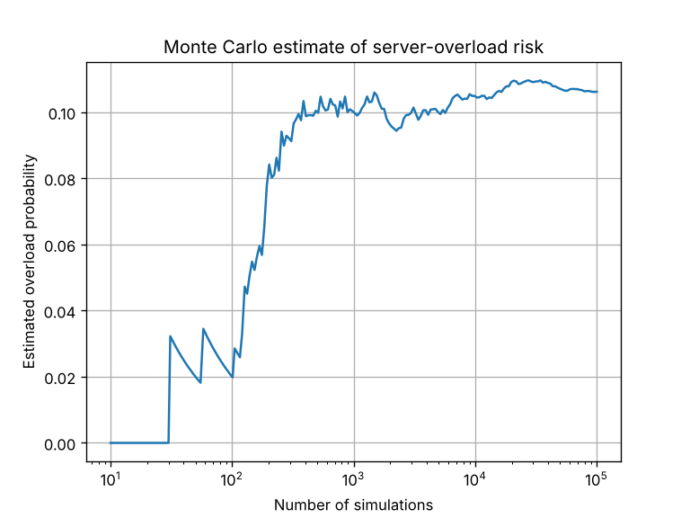
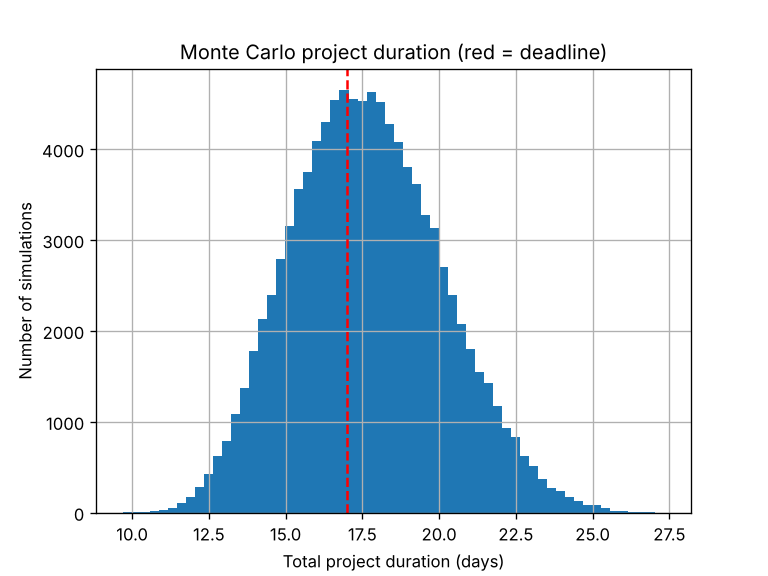

# Task 20: Random Numbers and Monte Carlo Methods

Programs: [`code/Task_20_monte_carlo.py`](../code/Task_20_monte_carlo.py) (original) and [`code/Task_20_monte_carlo_modified.py`](../code/Task_20_monte_carlo_modified.py) (modified)

## Original program output

```text
Estimated overload probability: 10.6160%
Number of overload cases: 10616 out of 100000
```



## B. Inputs and mathematical operation

**Input values:** server capacity 1000, demand with mean 850 and standard deviation 120 (normal distribution), 100,000 simulations, random seed 42.

**Mathematical operations:** generate random demand scenarios, count how many exceed the capacity, and estimate the overload probability as overloaded cases / total cases. A running estimate shows convergence.

## C. Changing a parameter

**Changes made:** capacity 1100, standard deviation 200, and only 1,000 simulations.

**Effect:** raising capacity to 1100 cut the overload probability from 10.6% to 1.9%. A more variable demand (std 200) raised it to 22.6%. With only 1,000 simulations the estimate was 11.0%, noisier than the 100,000-run value. (Check: (1000 - 850)/120 = 1.25 standard deviations, and the normal tail beyond that is about 10.56%, close to the simulation.)

## D. Meaning of the output

About 10.6% of the simulated scenarios overload the server (10,616 of 100,000), roughly 1 in 9 or 10. **Graph:** at the left, with few simulations, the estimate jumps around; as the number of simulations grows (log scale) the line settles near 10.6%. More simulations give a more reliable estimate.

## E. Modified program for a related real-world case

**New case:** the risk that a project misses its deadline.

**Assumptions:** three tasks with uncertain durations in days (minimum, most likely, maximum): A (3, 5, 9), B (2, 4, 8), C (4, 6, 12); the tasks run one after another; the deadline is 17 days; 100,000 simulations.

**Interpretation:** the average total is 17.66 days, so the probability of finishing after 17 days is 58.66%. To be 90% sure, the plan would need about 20.9 days. **Graph:** a histogram of total durations, with the red dashed line at the deadline; more than half of the bars lie to its right.

**Output of the modified program** (Part C comparison, then Part E case):

```text
PART C
capacity=1000, std=120, N=100,000: overload probability = 10.6160%
capacity=1100, std=120, N=100,000: overload probability = 1.9210%
capacity=1000, std=200, N=100,000: overload probability = 22.5690%
capacity=1000, std=120, N=  1,000: overload probability = 11.0000%

PART E - project deadline risk
Average total duration: 17.66 days
Probability of finishing after 17 days: 58.66%
90th percentile duration: 20.91 days
```


